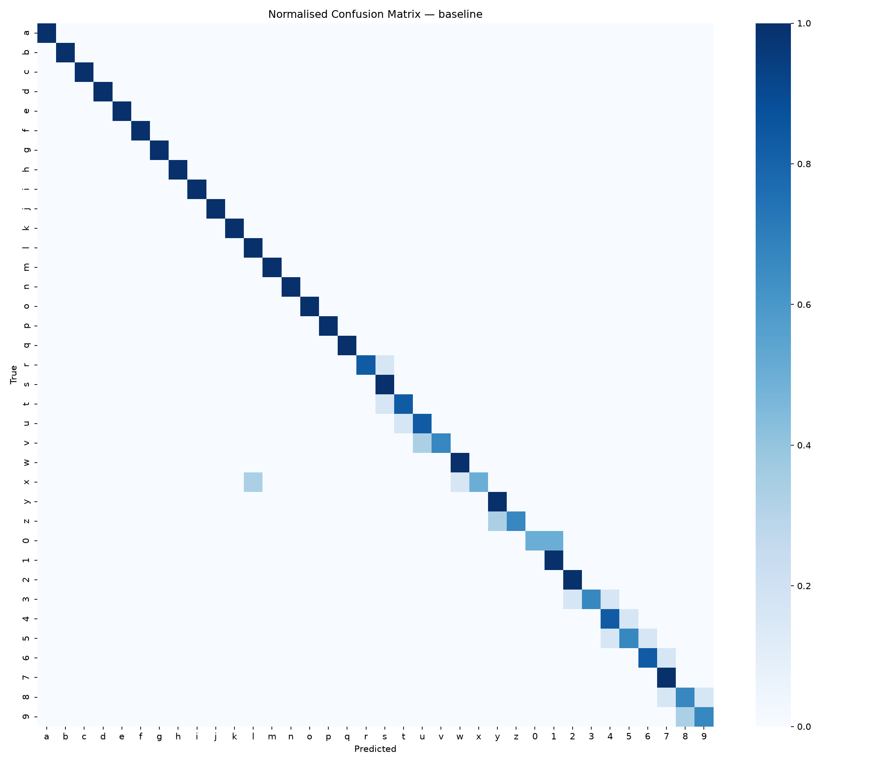
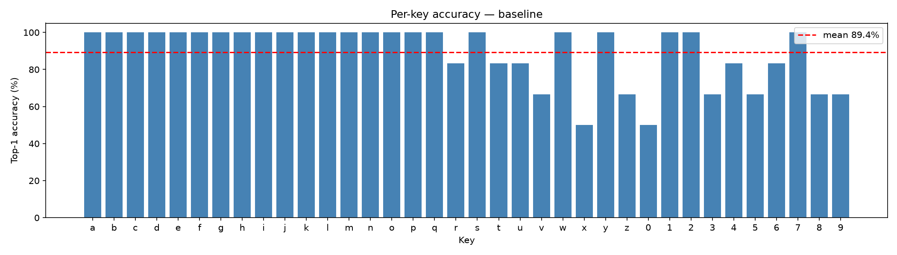
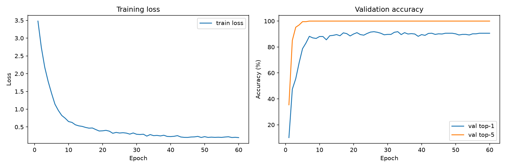

# 🎧 Acoustic Keystroke Recovery

> **Can a computer figure out what you typed just by *listening* to your keyboard? Yes — and this project shows how.**

This is my end-to-end machine-learning pipeline that takes **microphone audio of someone typing** and reconstructs the **text they typed**, using nothing but the *sound* of each key. It's an "acoustic side-channel attack" on keyboards, built as a hands-on **security-research and deep-learning project**.

```
raw audio  ─►  isolate each keystroke  ─►  mel-spectrogram  ─►  CNN / CoAtNet  ─►  recovered text
```

It runs the full loop: record → cut each keystroke out of the audio → turn it into a spectrogram "image" → classify which key it was → stitch the keys back into words (with a dictionary to fix mistakes).

---

## 📑 Table of contents

- [How I got the idea](#-how-i-got-the-idea)
- [What it does](#-what-it-does)
- [What I used (tech stack)](#-what-i-used-tech-stack)
- [Problems I faced — and how I solved them](#-problems-i-faced--and-how-i-solved-them)
- [Results](#-results)
- [Quick start (no microphone needed)](#-quick-start-no-microphone-needed)
- [Full usage with a real microphone](#-full-usage-with-a-real-microphone)
- [Project structure](#-project-structure)
- [⚖️ Legal & ethical use (please read)](#️-legal--ethical-use-please-read)
- [Terms of use](#-terms-of-use)
- [Acknowledgements & prior work](#-acknowledgements--prior-work)
- [License](#-license)

---

## 💡 How I got the idea

I've always been fascinated by **how much information leaks out of a device without anyone realising it** — not through hacking the software, but through the *physical world* around it: power draw, electromagnetic noise, timing… and **sound**.

I came across the idea that mechanical keys don't all sound the same — each key sits in a slightly different spot and makes a slightly different *click* — and that researchers had shown you could train a neural network to tell keys apart from audio alone. There's a well-known 2023 paper on exactly this (Harrison et al., see [acknowledgements](#-acknowledgements--prior-work)).

That blew my mind, so I decided to **build it myself** to really understand it: not just read about the attack, but implement the whole pipeline, make it run, break it, fix it, and learn where it's strong and where it falls apart. This repo is the result.

> My goal is **defensive and educational**: understanding the attack is the first step to defending against it. See [Legal & ethical use](#️-legal--ethical-use-please-read).

---

## 🔍 What it does

Each stage is its own script so the pipeline is easy to follow:

```
microphone ─► [collect_data.py] ─► continuous WAV + a CSV of which key was pressed when
                                        │
                              [isolate.py / realign.py] ─► one short clip per keystroke
                                        │
                                 [dataset.py] ─► 64×64 log-mel spectrogram per clip
                                        │
                                  [train.py] ─► BaselineCNN or CoAtNet classifier
                                        │
                                [evaluate.py] ─► accuracy + confusion matrix
                                        │
                                   [demo.py] ─► recovered text (+ dictionary correction)
```

**Why it works:** every key press is a tiny impact that produces a characteristic burst of sound, shaped by the key's position and the way it's hit. A mel-spectrogram captures that sound as an image, and an image classifier learns to map it back to a letter.

---

## 🧰 What I used (tech stack)

| Area | Tools |
|---|---|
| Language | **Python 3** (built and tested on 3.14) |
| Deep learning | **PyTorch**, **timm** (CoAtNet-0), plus my own pure-PyTorch **NativeCoAtNet** |
| Audio / DSP | **librosa**, **soundfile**, **sounddevice**, **scipy** (mel-spectrograms, onset detection, resampling) |
| Data collection | **pynput** (key logging synced to the audio clock) |
| ML tooling | **scikit-learn** (stratified splits), **NumPy** |
| Language model | **nltk** word list for noisy-channel word correction |
| Plots | **matplotlib**, **seaborn** (confusion matrix, per-key accuracy, training curves) |

Core ML ideas I implemented: **log-mel spectrograms**, a **from-scratch CNN**, a **CoAtNet (conv + transformer) hybrid**, **SpecAugment**-style augmentation, **LR warmup + cosine schedule**, and a **noisy-channel dictionary decoder**.

---

## 🧩 Problems I faced — and how I solved them

This is the part I'm most proud of, because getting it to actually *run* was harder than the machine learning. Here are the big ones, kept simple:

### 1. My Python version broke the deep-learning libraries
**Problem:** I'm on **Python 3.14**, which is very new. `torchvision` (needed by `timm` for the pretrained CoAtNet) has no working build for 3.14 yet — and because `timm` imports it on load, it crashed *everything*, even the simple CNN.
**Fix:** I made the `timm` import **lazy** (only load it if it actually works) and wrote my own **`NativeCoAtNet`** — a self-contained conv-plus-transformer network in pure PyTorch with no `timm`/`torchvision` dependency. Now both models run on any Python that runs PyTorch.

### 2. PyTorch refused to load (`WinError 206`)
**Problem:** On Windows, PyTorch's DLLs fail to load when the project sits in a very long folder path (the classic 260-character limit).
**Fix:** Kept the project at a **short path** and, while developing in a deep folder, pointed a **directory junction** (`mklink /J`) at it so the path PyTorch sees stays short.

### 3. The libraries were installed but didn't match
**Problem:** `torch 2.15` and the available `torchvision` were built against *different* versions, so the app crashed with `operator torchvision::nms does not exist`.
**Fix:** Pinned a **matched pair** (`torch 2.14.1` + `torchvision 0.29.2`) from the official PyTorch index so their compiled parts line up.

### 4. I couldn't test anything without recording 900 keystrokes first
**Problem:** The pipeline needs a microphone and a long typing session before you can train *anything*, which makes it impossible to verify the code is correct.
**Fix:** I built **`synth_data.py`**, a synthetic keystroke generator. It fabricates physically-plausible key sounds (a broadband "click" + a key-specific resonant tail) so the **whole pipeline runs end-to-end in seconds, with no hardware**. (These are clearly *not* real recordings — they prove the code is correct, not that the attack works in the wild.)

### 5. The demo kept dropping the first keystroke
**Problem:** On a test phrase, the recovered text came out as `ello` instead of `hello` — the onset detector was throwing away the first key.
**Fix:** My first synthetic keys were pure tones; real key presses are **broadband clicks**. I rebuilt the generator to emit a realistic broadband click and **normalised each keystroke by RMS** so every press is equally loud and detectable. Detection went from 4/5 to **5/5** and the demo recovered the full word.

### 6. The dictionary step crashed offline
**Problem:** The word-correction stage downloaded an `nltk` word list and crashed with no internet.
**Fix:** Made it **merge a built-in common-word list with `nltk` when available** and fall back gracefully otherwise, so it always works.

---

## 📊 Results

Measured on the **synthetic dataset** (36 classes: `a`–`z`, `0`–`9`), as a correctness check of the full pipeline:

| Model | Test top-1 | Test top-5 |
|---|---|---|
| BaselineCNN | **89.4%** | 100% |
| NativeCoAtNet | **88.4%** | 100% |

And the end-to-end demo recovers typed text from audio:

```
Detected 5 keystrokes in 2.40s of audio
  [1] h (p=0.96)   [2] e (p=0.97)   [3] l   [4] l   [5] o (p=0.96)
Greedy prediction :  hello
LM-corrected      :  hello
```





> **Honest note on these numbers:** they come from *synthetic* audio, so they validate that the pipeline is correct — they are **not** a claim about real-world attack accuracy. On real recordings the published research reports roughly **90–95% on the same recording setup**, dropping sharply (to ~40%) on a completely different recording. Reproducing those real-world numbers is the next step (record your own typing — see below).

---

## 🚀 Quick start (no microphone needed)

```bash
# 1. Install PyTorch (CPU build shown; see note below for Python 3.14)
pip install torch --index-url https://download.pytorch.org/whl/cpu
pip install -r requirements.txt

# 2. Make a synthetic dataset + a demo phrase (no hardware required)
python synth_data.py --per-key 40 --phrase hello

# 3. Train, evaluate, and recover the text
python train.py    --model baseline --clips data/clips_aligned
python evaluate.py --model baseline
python demo.py     data/raw/hello.wav --model baseline --lm --word-lengths 5
```

That last command prints `hello`, recovered from audio alone.

> **On Python 3.14:** `pip install torch==2.14.1 torchvision==0.29.2 --index-url https://download.pytorch.org/whl/cpu` is the matched pair that works. `timm` isn't required — the project automatically uses `NativeCoAtNet`. For the *pretrained* CoAtNet-0, use Python 3.11–3.13 and `pip install timm torchvision`.
>
> **Windows:** if PyTorch fails to load with `WinError 206`, your folder path is too long — move the project nearer the drive root (e.g. `C:\dev\akr`).

---

## 🎤 Full usage with a real microphone

```bash
python collect_data.py meter                 # set your mic level first
python collect_data.py guided session01      # type each key as prompted
python realign.py data/raw/session01.wav data/raw/session01.csv
python train.py   --model baseline --clips data/clips_aligned
python demo.py    data/raw/session01.wav --model baseline
```

**Only record your own typing**, or someone who has explicitly agreed. See below.

---

## 📁 Project structure

```
├── config.py          All settings and paths
├── collect_data.py    Record mic audio + log keypresses
├── isolate.py         Cut keystrokes out by onset detection
├── realign.py         Re-centre clips precisely on each keystroke
├── dataset.py         Audio → log-mel spectrogram dataset
├── models.py          BaselineCNN, CoAtNet, and my NativeCoAtNet fallback
├── train.py           Training loop + augmentation + checkpointing
├── evaluate.py        Confusion matrix + accuracy plots
├── decode.py          Dictionary-based word correction
├── demo.py            Full "audio → recovered text" demo
├── synth_data.py      No-microphone synthetic data generator (my addition)
├── diagnose.py        Data-quality diagnostics
├── inspect_snr.py     Signal-to-noise inspection of a recording
└── requirements.txt
```

See [IMPROVEMENTS.md](IMPROVEMENTS.md) for a detailed changelog of what I added and fixed.

---

## ⚖️ Legal & ethical use (please read)

This project is shared for **education, research, and defensive-security awareness** — to help people understand that keyboard sounds can leak information, so they can protect themselves.

**You may:**
- Run it on **your own typing**, on **your own devices**.
- Use it on audio from **people who have given clear, informed consent**.
- Use it for learning, academic study, and defensive research.

**You may NOT:**
- Record, analyse, or attempt to recover anyone's keystrokes **without their explicit permission**.
- Use it to capture passwords, messages, or any private information belonging to other people.
- Use it for surveillance, stalking, fraud, or any unlawful purpose.

Secretly recording someone to recover what they typed is almost certainly **illegal** (wiretapping, computer-misuse, and privacy laws apply in most countries) as well as unethical. **Don't do it.**

**Defences this project highlights:** use an on-screen keyboard for sensitive input, play background noise/typing-sound masking, type on a padded surface, and keep untrusted microphones away while entering passwords.

---

## 📜 Terms of use

By downloading, running, or modifying this software you agree that:

1. **You are solely responsible** for how you use it and for complying with all laws and regulations that apply to you.
2. You will use it **only** on data you own or are explicitly authorised to analyse.
3. The software is provided **"as is", with no warranty** of any kind (see [License](#-license)). The author is **not liable** for any damage, loss, or legal consequence arising from its use or misuse.
4. You will **not** use it to violate anyone's privacy or any law.

If you do not agree with these terms, do not use this software.

---

## 🙏 Acknowledgements & prior work

This is **my implementation**, but I stand on published research and open-source work, and I want to credit it honestly:

- **Harrison, Toreini & Mehrnezhad**, *"A Practical Deep Learning-Based Acoustic Side Channel Attack on Keyboards"*, IEEE EuroS&PW 2023 — [arXiv:2308.01074](https://arxiv.org/abs/2308.01074). The paper that inspired this project and whose approach I reproduce.
- **Asonov & Agrawal**, *"Keyboard Acoustic Emanations"*, IEEE S&P 2004.
- **Zhuang, Zhou & Tygar**, *"Keyboard Acoustic Emanations Revisited"*, ACM CCS 2005.
- The open-source **PyTorch**, **librosa**, and **timm** communities.

This repository builds on an MIT-licensed reference implementation of the pipeline; the original copyright is retained in the [LICENSE](LICENSE) alongside my own, as the license requires.

---

## 📄 License

Released under the **MIT License** — see [LICENSE](LICENSE). Provided for educational and defensive-security purposes only.
